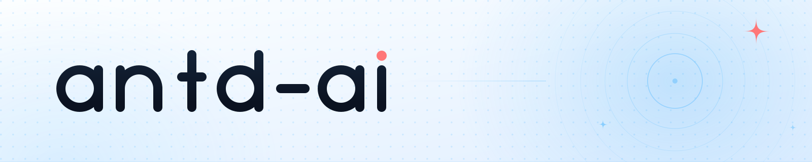
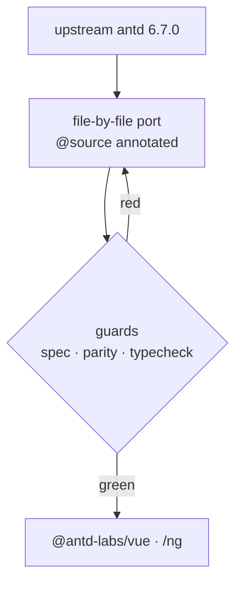

  <picture>
    <source media="(prefers-color-scheme: dark)" srcset="./assets/hero-dark.svg">
    
  </picture>

  
  
  
  

## Ant Design, rebuilt 1:1 — for every framework, by AI.

We don't take inspiration from antd and write a lookalike. We open the official source
and port it **file by file, line by line** into Vue and Angular components.
When antd ships a release, we change the same lines they changed.

| 🧩 1:1 Parity | 🤖 AI-Maintained | 🎯 Framework-Agnostic |
| :-- | :-- | :-- |
| Files, styles, demos and docs map one-to-one to upstream. A missing file means the component isn't done. | Upstream source → port → guard scripts run end to end on AI. Humans arbitrate, not type. | Kernels (tokens / icons / util) carry zero framework imports and are shared by Vue and Angular. |

### What we build

| Package | Runtime | What it is |
| :-- | :-- | :-- |
| `@antd-labs/tokens` | — | seed / map / alias tokens and their derivation functions |
| `@antd-labs/icons` | — | SVG definitions generated from `@ant-design/icons-svg` |
| `@antd-labs/util` | — | pure helpers: `isRenderable`, `useControlledState`, `omit`, `pickAttrs` |
| `@antd-labs/motion` | Vue | the `CSSMotion` equivalent of `@rc-component/motion` |
| `@antd-labs/trigger` | Vue | popup positioning, portal and focus from `@rc-component/trigger` |
| `@antd-labs/vue` | Vue 3 | components plus the Vue layer of cssinjs and theme |
| `@antd-labs/ng` | Angular | the same kernels, rendered by Angular components |

### Why 1:1

| ❌ The usual way | ✅ Our way |
| :-- | :-- |
| "Follow the antd look" and rewrite from scratch | Read the upstream file and port it verbatim |
| Chase upstream releases by hand | Upstream changes a line, we change the same line |
| Looks similar, behaves differently | Selectors, values and branch structure stay identical |

The only allowed deviations are a `// @source <upstream path>` header and four categories of
explicit adaptation — each declared as `// @adapt <reason>` and verified by `npm run spec`.

### How it's built

### Status

| Area | State |
| :-- | :-- |
| Tokens, cssinjs engine, theme | ✅ ported and verified byte-for-byte |
| Icon pipeline | ✅ generated from upstream sources |
| Vue components | 🚧 in progress, batches tracked by a parity script |
| Angular components | 🗺 planned on top of the same kernels |

<b>中文说明</b>

 

我们不做「参考 antd 的风格再写一套」。我们打开官方源码，**逐文件、逐行**移植成 Vue 与 Angular 组件；
官方发版时，我们改的是同一行。

| 原则 | 含义 |
| :-- | :-- |
| **1:1 对齐** | 文件、样式、demo、文档与上游一一对应；缺一个文件就算这个组件没做完 |
| **AI 维护** | 从读上游源码到守门脚本全流程由 AI 驱动，人只做仲裁 |
| **内核无框架** | tokens / icons / util 不含任何框架 import，Vue 与 Angular 共用同一套内核 |

允许的偏离只有两类：`// @source` 溯源声明，以及四类显式适配（每处都要写 `// @adapt <原因>`，
由 `npm run spec` 机器校验）。**「我们自己觉得这样写更好」不构成理由。**

---

Built in public by AI · <a href="https://github.com/antd-ai">antd-ai</a>

